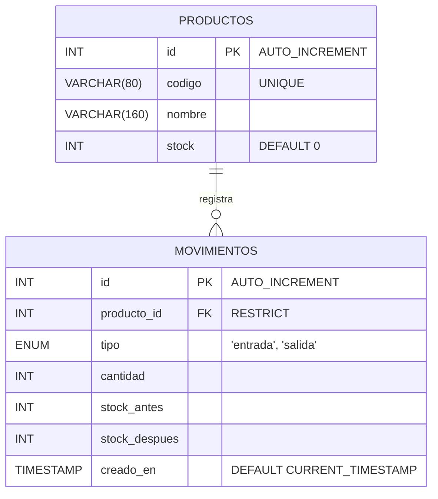
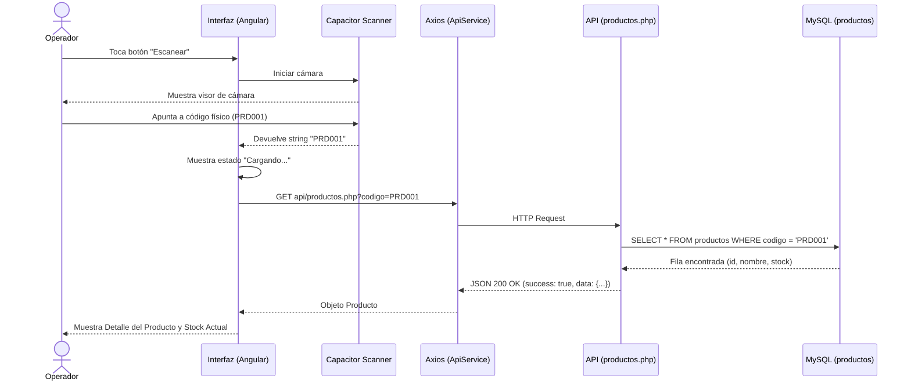
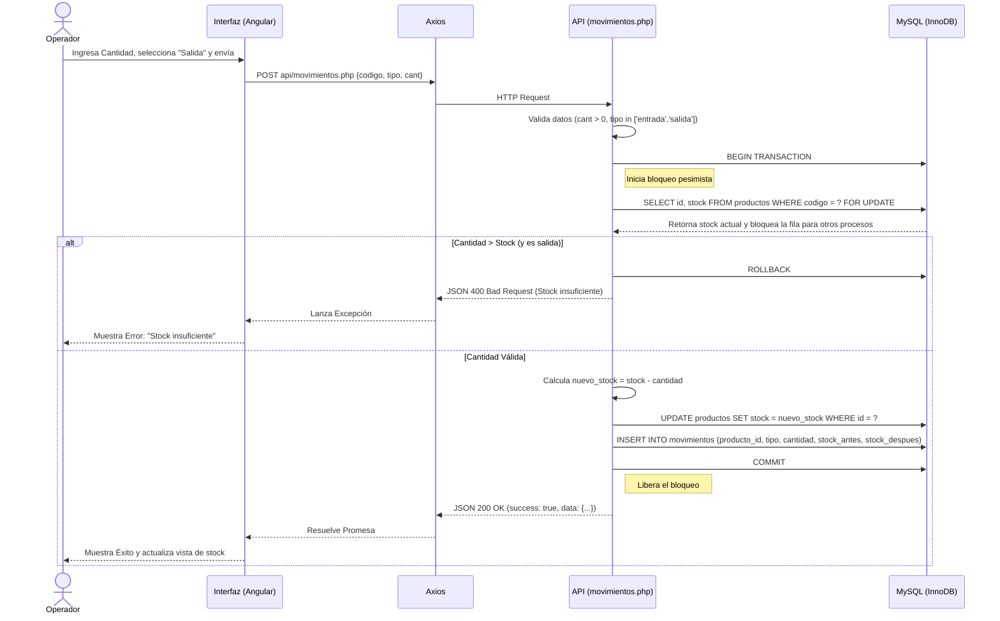

# FASE 1: DOCUMENTACIÓN TÉCNICA - PROYECTO 04 INVENTARIO QR
**Responsable:** Integrante 1 (Líder de Documentación)

---

## 1. DOCUMENTO DE DEFINICIÓN DEL PROYECTO

### 1.1. Definición del Problema
Actualmente, el control de inventarios físicos en almacenes se realiza de forma manual o mediante sistemas desconectados, lo que provoca lentitud en los procesos de auditoría, errores humanos en la captura de datos y falta de visibilidad en tiempo real del stock disponible. Esto deriva en inconsistencias graves entre el inventario físico y los registros digitales.

### 1.2. Justificación
Se requiere una solución ágil, móvil y conectada localmente que permita a los operadores actualizar el stock directamente desde los pasillos del almacén. El uso de la cámara de un dispositivo móvil para escanear códigos QR y de barras elimina los errores de transcripción, mientras que una conexión directa a una base de datos centralizada garantiza que la información de existencias sea precisa y en tiempo real.

### 1.3. Objetivo General
Desarrollar una aplicación móvil híbrida orientada a dispositivos Android que permita el control de existencias físicas mediante el escaneo de códigos QR y de barras, sincronizando las entradas y salidas en tiempo real con una base de datos MySQL alojada en una red local (LAN).

### 1.4. Objetivos Específicos
1. **Integración de Escáner:** Implementar la lectura de códigos QR y Code 128 utilizando el plugin `@capacitor/barcode-scanner` en un entorno Ionic/Angular.
2. **Desarrollo de API REST:** Construir un backend en PHP 8.x con arquitectura modular y PDO para exponer endpoints seguros y eficientes.
3. **Consistencia Transaccional:** Garantizar la integridad de los datos en la base de datos aplicando bloqueos pesimistas (`SELECT ... FOR UPDATE`) para evitar sobregiros de stock ante peticiones concurrentes.
4. **Resiliencia de Red:** Asegurar el manejo correcto de peticiones HTTP utilizando `Axios` desde el frontend, interpretando y mostrando al usuario los errores de conectividad o validación de manera legible.

### 1.5. Usuarios y Audiencia
- **Operadores de Almacén:** Encargados de realizar el escaneo físico de los productos y registrar el movimiento de entrada o salida.
- **Supervisores de Inventario:** Personal que consulta las existencias actuales y revisa el historial reciente de movimientos.

### 1.6. Alcance y Fronteras del Proyecto
**Incluye:**
- Gestión de unidades físicas de productos previamente registrados en la base de datos.
- Registro de transacciones de entrada y salida con cálculos atómicos.
- Persistencia de datos 100% en MySQL a través de red local.

**Límites Estrictos (FUERA DEL ALCANCE):**
> ⚠️ **IMPORTANTE:** Este proyecto está acotado estrictamente a la gestión de unidades de almacén. 
> - **NO INCLUYE** sistema de autenticación, usuarios, roles ni inicio de sesión (Login).
> - **NO INCLUYE** pasarela de pagos, carritos de compras, ventas, facturación ni gestión de precios.
> - **NO UTILIZA** datos simulados en memoria (mock data); toda interacción es directamente con la base de datos MySQL.

### 1.7. Asignación de Roles del Equipo
| Rol | Integrante | Responsabilidades Principales |
|:---:|:---|:---|
| **Líder de Documentación** | Integrante 1 | Elaborar manuales, diagramas (Arquitectura, ER, Flujo), README, matriz de requisitos y control de IA (`IA_USADA.md`). |
| **Desarrollador Android & Core** | Integrante 2 | Inicialización Ionic Angular (NgModules), config `@capacitor/barcode-scanner`, permisos Android, generación de APK. |
| **Backend & Base de Datos** | Integrante 3 | Scripting SQL, config PDO, desarrollo de API REST en PHP, transacciones atómicas y manejo de concurrencia. |
| **Frontend UI & Conexión** | Integrante 4 | Pantallas de UI, consumo de API con Axios, manejo de estados (carga/éxito/error), feedback al usuario. |
| **QA e Integración** | Integrante 5 | Verificación de red LAN, impresión de códigos físicos, ejecución de pruebas (P01-P11), estrés transaccional, captura de evidencias. |

### 1.8. Evidencias de Entrega
Para comprobar el cumplimiento integral de los requisitos obligatorios, el equipo compilará en el repositorio las siguientes evidencias:
- APK de Android funcional y Código Fuente (sin directorios `node_modules`).
- Backend PHP y Base de Datos (Script `schema.sql`).
- Capturas o grabaciones en dispositivo físico ejecutando los flujos de lectura QR y de código de barras.
- Documento `IA_USADA.md` con validaciones de IA.
- Registro de pruebas P01-P11 aprobadas.

---

## 2. MATRIZ DE REQUISITOS Y TRAZABILIDAD

| ID | Tipo | Descripción | Responsable(s) | Casos de Prueba | Evidencia Esperada |
|:---|:---:|:---|:---|:---|:---|
| **REQ-01** | Funcional | La app debe leer códigos QR y Barras físicos usando la cámara del dispositivo móvil, permitiendo cancelación sin errores. | Int 2, Int 4 | P01, P05, P08 | Captura/Video de pantalla de escaneo leyendo código físico y retorno exitoso. |
| **REQ-02** | Funcional | El sistema debe consultar el producto en la BD a partir del código escaneado y devolver la información en tiempo real, validando si no existe. | Int 3, Int 4, Int 5 | P01, P05, P06 | Respuesta JSON 200/404 en consola y UI mostrando nombre/stock o error claro. |
| **REQ-03** | Funcional | El usuario debe poder registrar movimientos de "entrada" y "salida" afectando las existencias del producto escaneado. | Int 3, Int 4, Int 5 | P02, P03 | Registro insertado en la tabla `movimientos` y stock actualizado en `productos`. |
| **REQ-04** | Backend | El backend debe validar datos (ej. cantidades negativas) y aplicar bloqueos transaccionales para rechazar salidas si el stock es insuficiente (evitar sobregiro). | Int 3, Int 4, Int 5 | P04, P07, P10 | Respuesta JSON 400. Capturas de DB comprobando que el stock no quedó en números negativos. |
| **REQ-05** | No Funcional | El frontend debe gestionar correctamente la caída del servicio o falta de conectividad LAN y mostrar alertas detalladas. | Int 3, Int 4, Int 5 | P09 | App mostrando error 503 (Servicio no disponible) y URL/método tras apagar XAMPP. |
| **REQ-06** | No Funcional | La información debe persistir ininterrumpidamente en MySQL. La app debe mostrar el historial de movimientos de manera cronológica (DESC). | Int 4, Int 5 | P11 | Datos idénticos tras forzar cierre (kill) de la app y reabrirla (Historial cargado). |
| **EXT-01** | Extra (Opcional) | Alta de nuevos productos directamente desde la aplicación móvil. | Int 3, Int 4 | Fuera del MVP | N/A (Solo si sobra tiempo tras cumplir MVP). |
| **EXT-02** | Extra (Opcional) | Filtro de movimientos por producto específico en el historial. | Int 3, Int 4 | Fuera del MVP | N/A (Solo si sobra tiempo tras cumplir MVP). |
| **EXT-03** | Extra (Opcional) | Emisión de sonido de confirmación tras escaneo exitoso y vista de resumen del día. | Int 2, Int 4 | Fuera del MVP | N/A (Solo si sobra tiempo tras cumplir MVP). |

---

## 3. DIAGRAMAS DEL SISTEMA

### 3.1. Arquitectura en Capas
```mermaid
graph TD
    subgraph Frontend - Dispositivo Android
        A[App Móvil: Ionic + Angular] --> B(@capacitor/barcode-scanner)
        B --> A
        A --> C[ApiService: Axios]
    end

    subgraph Red Local LAN
        C -- Peticiones HTTP/JSON --> D((Red Wi-Fi Local))
        D -- Respuestas CORS --> C
    end

    subgraph Backend - Servidor XAMPP
        D --> E[Servidor Web: Apache]
        E --> F[API REST: PHP 8.x]
        F -- PDO (Transacciones) --> G[(MySQL: InnoDB)]
        G -- Resultados Query --> F
    end

    style A fill:#478bca,stroke:#fff,color:#fff
    style B fill:#3bc14a,stroke:#fff,color:#fff
    style C fill:#5a29e4,stroke:#fff,color:#fff
    style F fill:#8892bf,stroke:#fff,color:#fff
    style G fill:#e48e00,stroke:#fff,color:#fff
```

### 3.2. Diagrama Entidad-Relación (ER)


### 3.3. Secuencia: Escaneo y Consulta de Producto


### 3.4. Secuencia: Registro Atómico (Entrada/Salida) con Bloqueo
